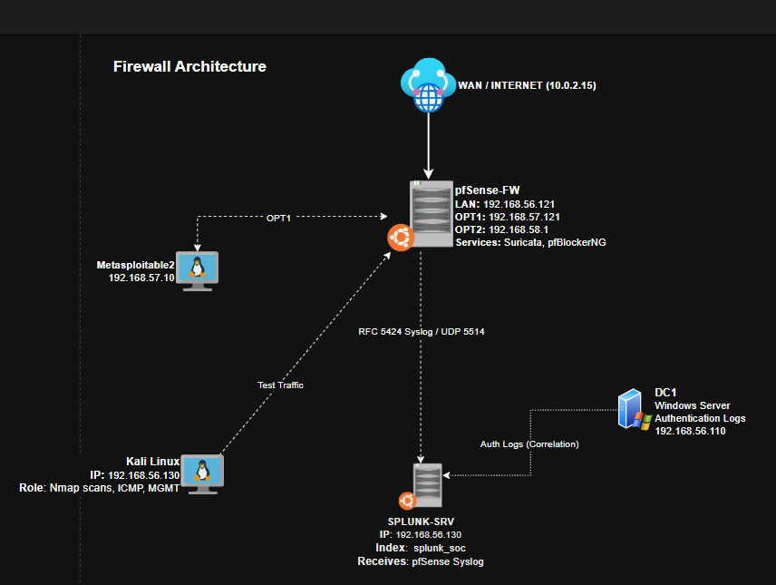
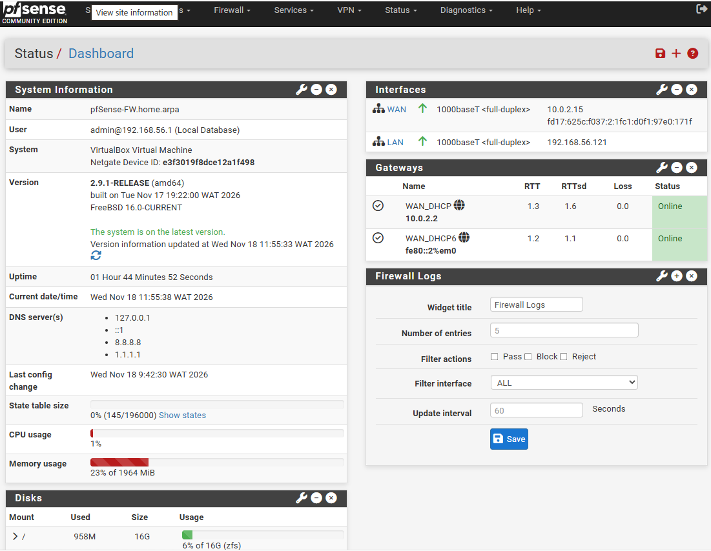
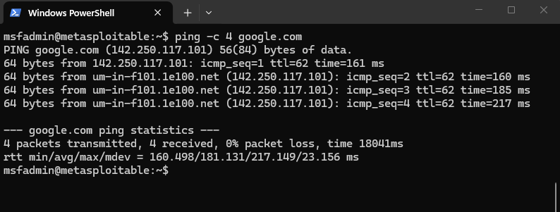
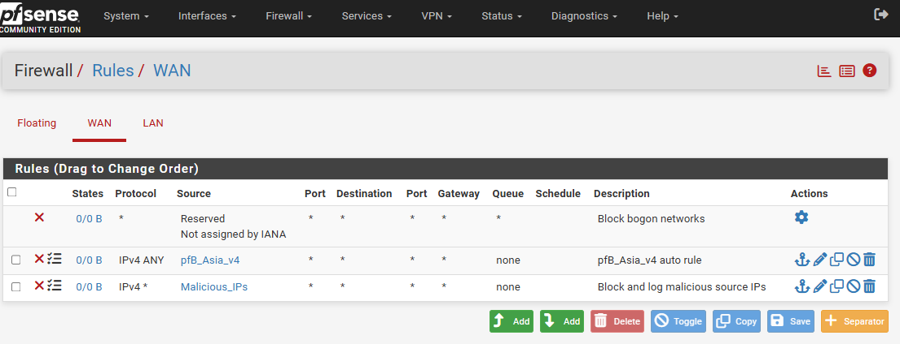
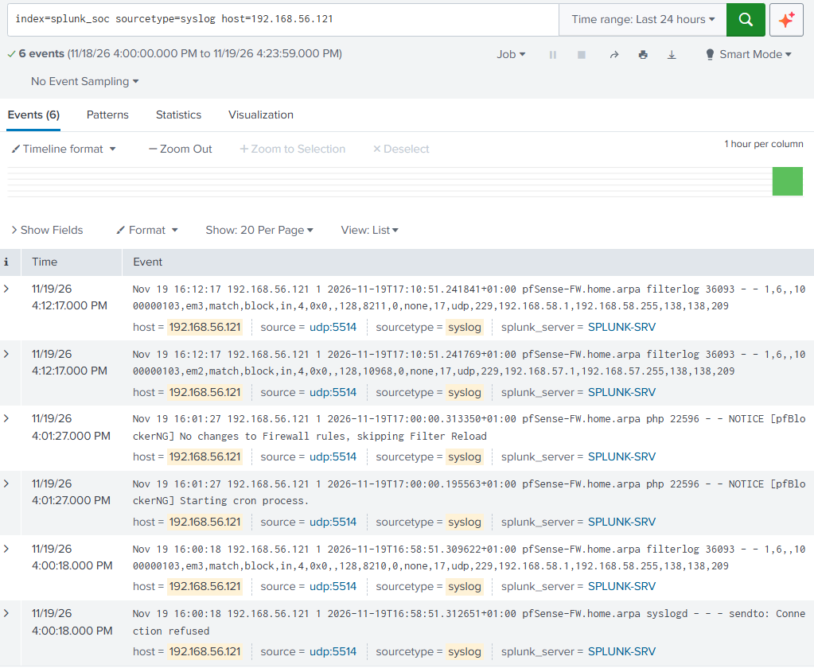
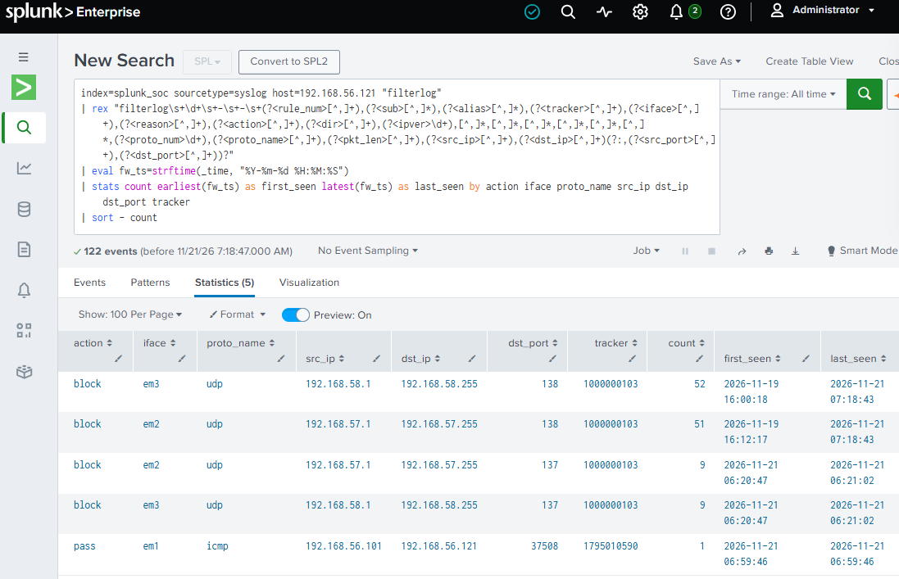
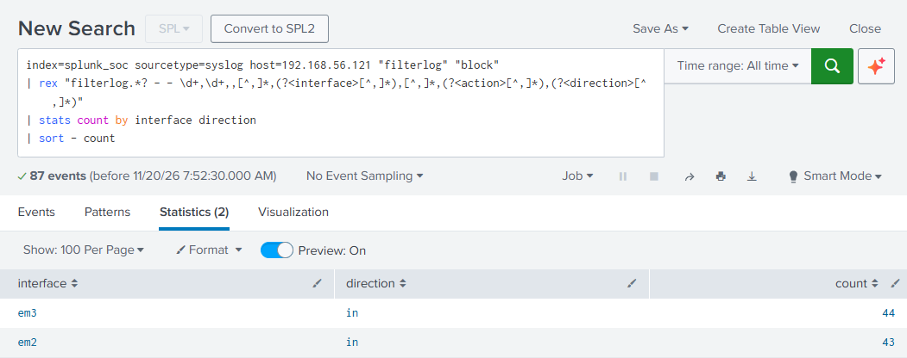
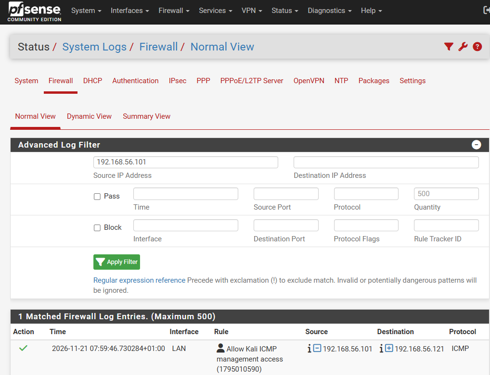
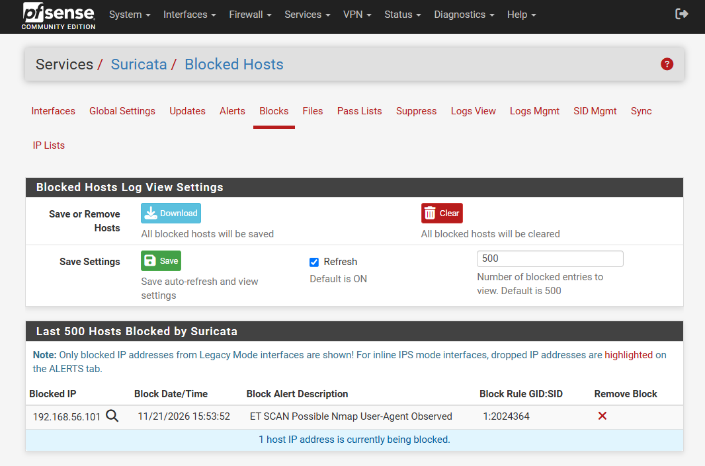
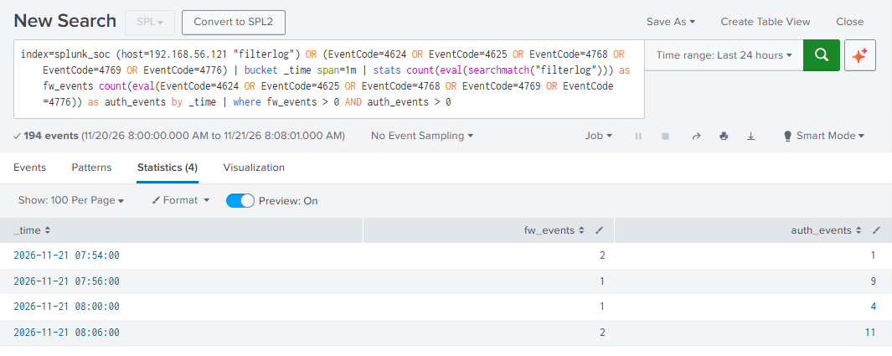

# Firewall Monitoring and Analysis

## 1. Objective
Deploy and harden a pfSense firewall within a virtualized lab environment, implement network security controls and intrusion detection, integrate pfSense logs with Splunk for centralized monitoring, and validate traffic routing, alerting, logging, and security event correlation through controlled testing.

## 2. Architecture

## 3. Tools & Technologies

| Tool | Purpose |
|---|---|
| pfSense | Firewall, routing and network segmentation |
| Suricata 8.0.7 | Network IDS/IPS |
| Splunk Enterprise | Centralized logging and investigation |
| pfBlockerNG-devel | IP and GeoIP filtering |
| VirtualBox | Virtual lab infrastructure |
| Kali Linux | Controlled security testing |
| Metasploitable2 | Isolated test target |
| MaxMind GeoLite2 | GeoIP data |

## 4. Implementation & Validation

### 4.1 Firewall Deployment & Segmentation
- Deployed pfSense in VirtualBox with WAN, LAN and isolated `OPT1`/`OPT2` host-only segments.
- Routed Metasploitable2 through pfSense as gateway and DNS resolver after replacing `172.16.123.2`.
- Verified internet, LAN and `OPT1` gateway/DNS connectivity (4/4 pings, 0% packet loss) and confirmed dashboard health (6% disk usage).

**Evidence:** 

**Evidence:** 

### 4.2 Firewall Hardening and Access Control
- Enabled WAN bogon blocking, retained default implicit-deny protection, and organized rules using management, inbound, and outbound separators.
- Restricted Remote_Mgmt_Ports `TCP 80, 443, 22` to Kali, configured a logged WAN test-block rule for `Malicious_IPs` `203.0.113.10` and enforced explicit LAN egress rules for DNS, HTTP, and HTTPS.
- Installed `pfBlockerNG-devel` with MaxMind GeoLite2 and enabled `pfB_Asia_v4` GeoIP filtering.

**Evidence:** 

### 4.3 Syslog Forwarding & Splunk Integration
- Configured pfSense RFC 5424 remote syslog forwarding over UDP `5514` into Splunk (`sourcetype=syslog`, `index=splunk_soc`).
- Validated transport and ingestion of firewall `filterlog` and `pfBlockerNG` notices using test events on 22 November 2026 at `19:08:29` and `19:12:18`.

**Evidence:** 

### 4.4 Firewall Traffic Investigation
- Analyzed `filterlog` events in Splunk by rule ID, interface, action, direction, IP, and port, confirming all observed drops hit default rule `1000000103`.
- Identified routine internal NetBIOS broadcast drops (`UDP/138`) from interface IPs to subnet broadcast addresses across `OPT1` (`em2`) and `OPT2` (`em3`): 87 events in the initial sample (43 `OPT1`, 44 `OPT2`; max 2 per 5-minute bucket) and 103 events across the full 19–21 November window (51 `OPT1`, 52 `OPT2`).
- Isolated a 15-second `UDP/137` burst on 21 November 2026 (`06:20:47`–`06:21:02`) with nine blocked events per interface, consistent with routine broadcast noise rather than confirmed malicious activity.

**Evidence:** 

### 4.5 Firewall Rule Troubleshooting
- Investigated missing Kali ICMP pass events in Splunk.
- Identified that the broad default LAN allow rule (`@99`) intercepted traffic before the specific ICMP logging rule (`@101`).
- Moved the Kali ICMP rule above the default allow rule.
- Verified successful pass logging from `192.168.56.101` to `192.168.56.121` under tracker `1795010590` at 21 November 2026, 06:59:46.

**Evidence:** 

### 4.6 Suricata IDS/IPS Deployment & Blocking Validation
- Installed Suricata `v7.0.10` (engine `v8.0.7`) on `em1` (`LAN_IDS`); disabled hardware checksum, TSO, and LRO.
- Configured Emerging Threats Open, Feodo Tracker Botnet C2, and abuse.ch SSL Blacklist rulesets (22,710 loaded; 9 failed due to JA3/PostgreSQL compatibility); enabled Block Offenders (Inline Mode not validated).
- Generated controlled Nmap HTTP traffic from Kali to pfSense, triggering `ET SCAN Possible Nmap User-Agent Observed` (`1:2024364` / `1:2024364:5`) across four initial alerts at 15:26:34 on 21 November 2026, `snort2c` offender blocking at 15:53:52, and a `[Drop]` entry in `alerts.log` on 22 November 2026 at 20:13:11.524815.

**Result:** Controlled signature detection and offender blocking were validated.

**Evidence:** 

### 4.7 SIEM and Authentication Review
- Reviewed Windows authentication telemetry from DC1, WS01 and target-pc.
- Confirmed Event ID 4625 data existed, but the latest failed-logon events ended on 10 November 2026, outside the reviewed firewall-log window of 19–22 November.
- Identified seven overlapping one-minute firewall/authentication event buckets on 21 November 2026, between 07:54 and 08:42.
- Filtering out computer accounts (`*$`) left zero user or external logon events in those overlapping buckets.
- The observed overlap was associated with routine DC1$ Kerberos network logons, not demonstrated intrusion activity.

**Finding:** Temporal overlap was observed, but malicious authentication correlation was not established.

## 5. Findings & Security Assessment
- Blocked internal NetBIOS broadcast traffic was identified and characterized across OPT1 and OPT2.
- No multi-port scan sweep was observed in the reviewed pfSense filterlog dataset.
- No blocked external/non-RFC1918 IPv4 sources targeting the reviewed private networks were identified.
- No user or external authentication correlation was established in the reviewed overlapping time windows.
- Verified Suricata EVE TLS ingestion in Splunk on 22 November 2026 at 18:44:27.

**Security decision:** The reviewed firewall and authentication evidence did not establish an intrusion or compromise; findings were documented as baseline traffic and telemetry observations.

## 6. Limitations & Future Improvements
- Native `filterlog` limits visibility to Layer 3/4 metadata rather than full HTTP or application context; integrate DNS and proxy telemetry, such as Squid, for additional domain and application visibility.
- Validate Suricata EVE alert forwarding into Splunk.
- Evaluate and validate Suricata Inline Mode separately.
- Extend correlation across firewall, authentication, endpoint and network telemetry.

## 7. Operational Impact
Improved network visibility and access control through centralized firewall logging, traffic investigation, and validated intrusion detection and blocking. Identified telemetry gaps to guide monitoring improvements.